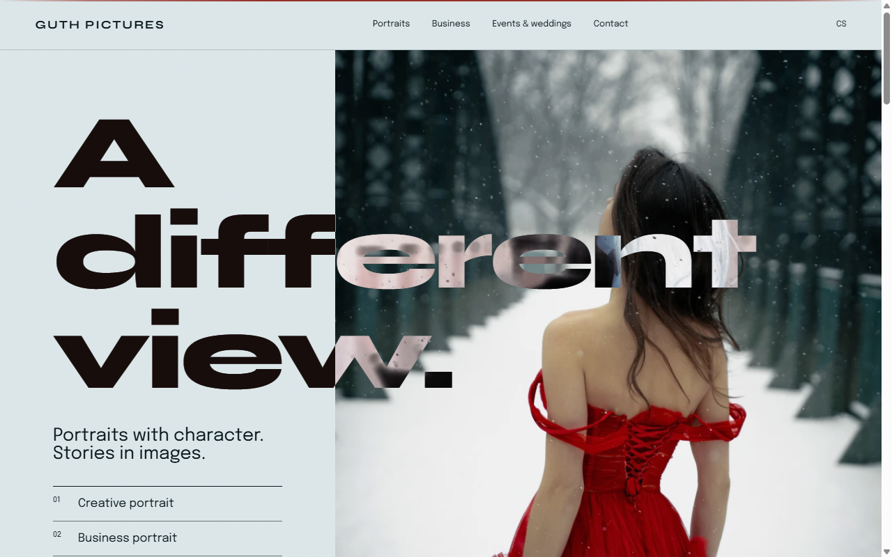

# Guth Pictures



Website and back office of a portrait photographer — public portfolio, client galleries, proposals, a blog and a small set of interactive photo tools, all in one Next.js app.

**Live:** <https://www.guthpictures.eu>

## What's inside

**Public site (CS / EN)**
- Portfolio, services with pricing, business portraits landing page, blog.
- Homepage palette derived from the hero photo's colors via Cloudinary.
- **Light Tester** — an interactive 3D studio-lighting simulator (three.js): light types, color temperature, gels, intensity and position on a portrait head.
- **Focení 101** — a scroll-driven 3D story explaining aperture, shutter speed, ISO and focal length to non-photographers.

**For clients**
- Password-protected galleries with photo selection, downloads and expiry.
- Personalised shoot proposals on their own URL.

**Admin**
- Content editor, theme editor, gallery management with Adobe Lightroom sync, blog CRUD, proposals.
- **Instagram stories pipeline** — Claude (Anthropic API) drafts story texts from photos, the admin approves them, and a GitHub Actions cron publishes them through the Instagram Graph API.
- **Portfolio butler** (`npm run portfolio`) — picks photos from a Google Drive folder, makes web versions and uploads them to Cloudinary.

## Stack

Next.js (App Router), React, TypeScript, Tailwind CSS, next-intl, Cloudinary, Vercel KV (Upstash Redis), three.js, Framer Motion, Anthropic SDK. Vitest + Testing Library for tests.

## Running locally

```bash
npm install
cp .env.example .env.local   # fill in Cloudinary, KV, admin password hash, …
npm run dev
npm test
```

Each feature lives in [`modules/`](modules/) with its own `MODULE.md`.

---

🇨🇿 **Česky:** Web a zázemí portrétního fotografa — portfolio, služby, klientské galerie s výběrem fotek, nabídky na míru, blog, interaktivní 3D simulátor světla a „Focení 101“. Admin s editorem obsahu, synchronizací z Lightroomu a automatickým publikováním Instagram stories (texty navrhuje Claude). Next.js + Cloudinary + Vercel KV.
